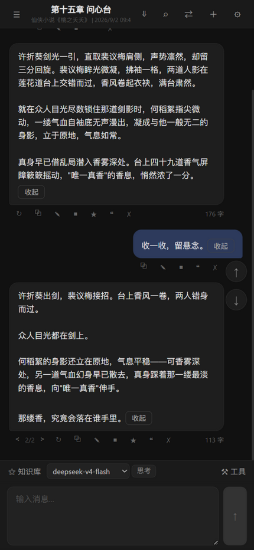
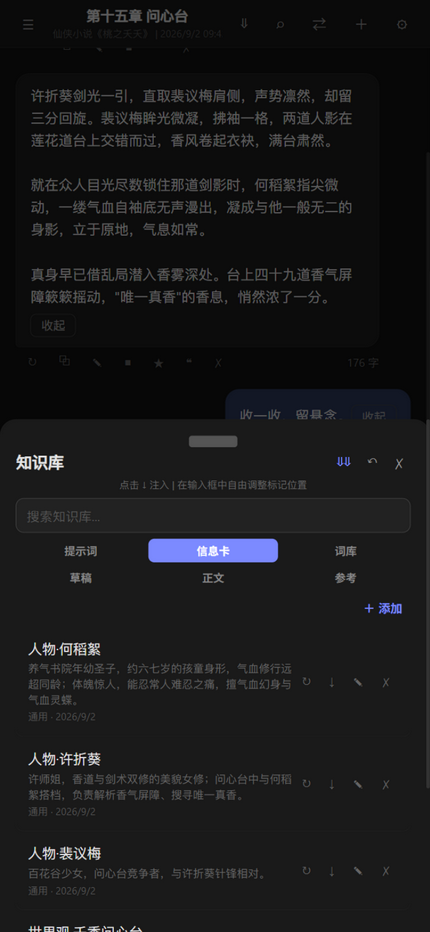
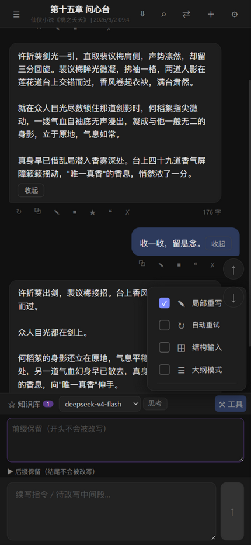
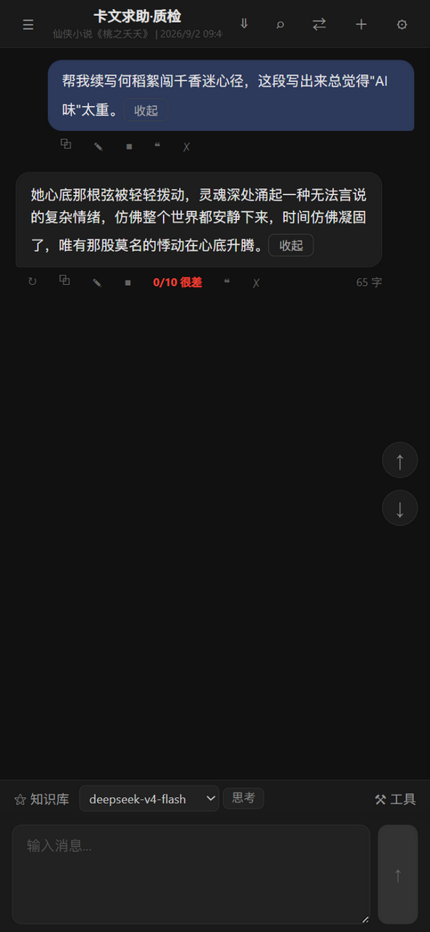

# 伏线簿 — 带剧情账本的移动端 AI 写作助手

伏线簿在移动端 AI 写作的基础上增加了项目级剧情账本：作者可以记录已确认事实、关键事件和未回收伏笔，生成与重试时自动注入当前项目资料，并导出账本继续备份或迁移。

一个面向中文创作者的 Android AI 写作工具，支持对话式续写、知识库注入、局部改写与实时质量检测。数据全部保存在本机；生成需联网调用所选模型 API。隐私优先。

新增「文脉」入口：可导入小说工作台的章节设定 JSON，将所选 AI 回复编辑后导出为候选稿 JSON；桌面工作台负责后续校验和人工确认事实入账。

## 快速体验

| 资源 | 链接 |
|------|------|
| 演示视频 | *待补充* |
| APK 下载 | https://github.com/Boundless-Fang/InkFlow/releases/download/v1.0.0/InkFlow-public.apk |

> 构建 APK 需要 Node.js 18+ 与 Android Studio，参见下方「从源码构建」。

---

## 界面预览

<p align="center">
  &nbsp;&nbsp;
  &nbsp;&nbsp;
  
</p>

<p align="center">
  
</p>

---

## 产品定位

**一句话**：让手机变成随身 AI 写作伙伴，而不是一个需要打开电脑才能用的工具。

**目标用户**：
- 网文作者：碎片时间续写章节、局部改写不满意段落
- 写作爱好者：灵感激发、文本润色、设定管理
- 学生：论文大纲辅助、文案生成

**核心产品决策**：

| 决策 | 原因 | 替代方案被排除的理由 |
|------|------|---------------------|
| APK 形态而非 Web | 创作者更习惯手机写作，离线可用 | PWA 安装入口深、离线与能力受限 |
| IndexedDB 本地存储 | 用户卸载不留云端数据，隐私优先 | SQLite 需 Capacitor 插件，跨平台兼容性差 |
| 直接对接模型 API | 用户自主控制 API Key，无中间服务商溢价 | 中转服务增加延迟和成本 |
| 纯前端架构 | 零服务端依赖，APK 即产品 | 后端部署维护成本高，与移动端定位冲突 |

---

## 核心功能

### 1. 对话式 AI 写作

- 流式生成：80ms 批处理渲染，降低逐字刷新开销
- 多模型支持：DeepSeek / SiliconFlow（DeepSeek V3.2+）/ OpenAI / Claude / Gemini
- 对话管理：新建 / 克隆 / 重命名 / 删除对话，自动按项目分组
- 上下文控制：可配置历史轮数 + Memory 摘要注入
- 版本管理：同一 prompt 多次重试，多版本无损切换

### 2. 知识库注入

- 支持将角色设定、世界观、大纲等作为知识库注入对话
- `{{kb:条目名}}` 模板标记：精确控制知识插入位置
- 按对话独立管理知识条目，启用/禁用/排序

### 3. FIM 局部重写

- 前缀保留（不动前文） + 后缀保留（不动后文）→ 只改写中间段
- 同时支持 Chat Completions（assistant prefix）和 FIM Completions 两种 API 模式
- 解决「只想改某个段落，不想全量重跑」的核心痛点

### 4. Slop 质量检测系统

自研 7 层 × 11 项加权的中文小说质量打分系统：

| 检测层 | 说明 |
|--------|------|
| Tier 1 绝对禁用词 | 字符串匹配（<1ms），覆盖常见 AI 套话 |
| Tier 2 可疑词簇 | 同段出现 ≥3 个可疑词触发警告 |
| Tier 3 禁用句式 | 正则匹配常见 AI 陈词滥调 |
| 小说 AI 信号（Fiction AI Tells） | 小说特有的 AI 生成信号检测 |
| 叙事直述（Show-Don't-Tell 违规） | 发现"告诉而非展示"的叙事模式 |
| 结构性修辞公式 | 检测机械重复的修辞结构 |
| 禁用比喻 | 绝对禁止 + 建议避免两级管控 |

**三种扫描模式**：
- 流式增量扫描：生成过程中持续检测
- 全量最终扫描：生成完成后出具完整评分报告
- 实时高亮扫描：轻量高频扫描，UI 即时标记

> 与 UI 的对应关系：设置中「打分频率」的「仅结束时」= 全量最终扫描；「持续扫描」= 流式增量 + 实时高亮。

### 5. 自动重试系统

- 基于 Slop 评分自动触发重试
- 可配置最低分阈值（默认 7 分）和最大重试次数（默认 3 次）
- 支持「仅结束时」和「持续扫描」两种策略

### 6. 结构化输入

- 多段输入模板，每段可折叠/展开
- 适合「大纲 → 正文」的结构化提示流程
- 模板预设（可从 prompts.json 加载）

---

## 技术架构

```
React 18 + TypeScript
├── Zustand (状态管理) + idb-keyval (IndexedDB 持久化)
├── Vite 5 (构建工具)
├── Capacitor 6 (Android APK 打包)
└── 直接对接大模型 API (OpenAI 兼容协议)

组件层次：
HomePage (~500 行主页面)
├── 历史侧栏：对话列表 / 项目分组 / 知识库
├── 消息区：流式渲染 / Markdown / 版本切换 / Slop 高亮
├── 输入区：文本输入 / 快捷模板 / FIM 局部重写 / 结构化输入
└── 工具面板：Slop 检测 / 自动重试 / 项目与提示词管理
```

关键数据流：

```
用户输入
  → fillTemplate(模板填充)
  → 收集 prefixText/suffixText (FIM 参数)
  → 注入 {{kb:条目名}} 标记内容
  → 构建消息列表 (含 memory / system prompt)
  → getClientApi().chat()
    ├── 普通对话 → /chat/completions (SSE 流式)
    ├── 前缀续写 → /beta/chat/completions (assistant prefix)
    └── FIM 补全 → /beta/completions (prompt + suffix)
  → onUpdate: 80ms 批处理渲染 + Slop 增量扫描
  → onFinish: IndexedDB 持久化 + Slop 全量报告
```

---

## 从源码构建

### 环境要求

- Node.js 18+
- npm 9+
- Android Studio (用于 APK 构建)

### 开发模式

```bash
# 安装依赖
npm install

# 启动开发服务器
npm run dev
# 浏览器访问 http://localhost:3000
```

### 构建 APK

```bash
# 构建 Web 资源 + 同步到 Capacitor Android 项目
npm run build:apk

# 然后在 Android Studio 中：
# Build → Build Bundle(s) / APK(s) → Build APK(s)
```

### 配置

创建 `.env` 文件（可选，也可在应用内设置）：

```env
VITE_DEFAULT_MODEL=deepseek-v4-flash
VITE_DEFAULT_PROVIDER=DeepSeek

# 使用硅基流动时（应用内也可设置）
VITE_SILICONFLOW_API_KEY=sk-your-key-here
VITE_SILICONFLOW_BASE_URL=https://api.siliconflow.cn/v1
```

首次使用时在设置页填入 API Key 即可。

---

## 产品迭代记录

### v1.0 (当前版本)

- [x] 多模型对话 (DeepSeek / SiliconFlow / OpenAI / Claude / Gemini)
- [x] 知识库注入与 {{kb:条目名}} 模板
- [x] FIM 局部重写 (前缀保留 + 后缀保留)
- [x] Slop 质量检测 (7 层 × 11 项加权)
- [x] 自动重试系统
- [x] 结构化多段输入
- [x] 对话版本管理与切换
- [x] IndexedDB 本地持久化
- [x] Capacitor Android APK 打包
- [x] 应用启动崩溃恢复 (清理孤儿 streaming 状态)

### 后续规划

- [ ] 文风偏移量化监测（文本向量距离比对）
- [ ] 角色一致性自动校验
- [ ] 写作统计面板 (字数趋势 / 生成质量趋势)
- [ ] 夜间模式
- [ ] iOS 适配 (Capacitor iOS)
- [ ] WebDAV 备份同步

---

## 目录结构

```
inkflow/
├── src/
│   ├── app/              # 入口、路由、全局样式
│   │   ├── App.tsx
│   │   ├── main.tsx
│   │   └── styles.css
│   ├── pages/
│   │   └── HomePage.tsx  # 主页面 (~500 行)
│   ├── components/       # 可复用组件
│   ├── hooks/            # 自定义 Hooks (useChat / useChecker / useDebounce)
│   ├── services/
│   │   ├── api/          # LLM API 封装 (流式/非流式)
│   │   ├── checker/      # Slop 检测器 + 重复检测
│   │   └── storage/      # IndexedDB 持久化层
│   ├── store/            # Zustand 状态管理
│   ├── types/            # TypeScript 类型定义
│   └── utils/            # 工具函数
├── public/
│   └── prompts.json      # 预设提示词模板
├── docs/                 # PRD、技术文档、打包指南、原型说明
├── portfolio/            # 作品集素材：可交互原型、界面截图
├── start.bat             # Windows 开发启动
├── apk.bat               # Windows APK 构建入口
├── apk-full.bat          # Windows 全量 APK 构建（clean build）
├── scripts/
│   ├── build-apk.sh      # Linux/Mac 构建脚本
│   └── bench/            # 检测基准评测脚本
├── dist/                 # 构建产物（web build、apk）
├── capacitor.config.ts   # Capacitor 配置
├── vite.config.ts        # Vite 配置
├── tsconfig.json
└── package.json
```

---

## License

MIT
